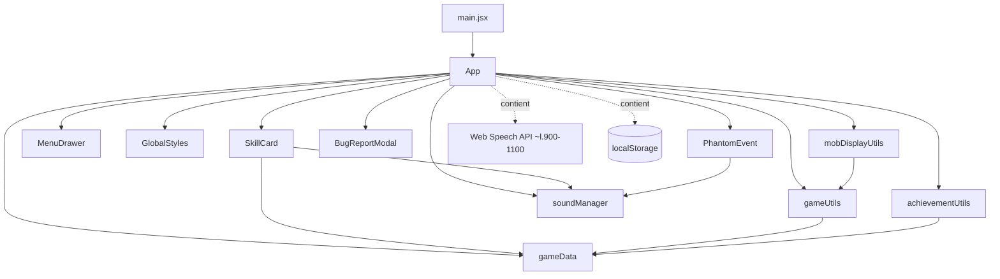

# DEBT.md — Registre de dette technique (CodeWashGame)

> Document vivant. Chaque PR de refactor référence un item `D-xx`. Les statuts sont mis à jour à chaque merge.
> Toute nouvelle dette découverte (ou introduite) est ajoutée ici.

- **Version du document :** v0.1 (mid-term)
- **Commit de référence (état reçu) :** `<tag P0-1, ex. v0.0-as-received>`
- **Dernière mise à jour :** `<date>`

> ⚠️ Les valeurs entre `<...>` sont à compléter après mesure. Les éléments marqués **(à vérifier)** viennent de l'analyse initiale et doivent être confirmés dans le code avant la défense.

---

## Sommaire

1. [Carte du codebase](#1-carte-du-codebase)
2. [Cartographie des I/O](#2-cartographie-des-io)
3. [Registre des dettes](#3-registre-des-dettes)
4. [Métriques de base](#4-métriques-de-base-avant-refactor)
5. [Matrice de risque et plan d'attaque](#5-matrice-de-risque-et-plan-dattaque)
6. [Lien avec GitHub](#6-lien-avec-github)
7. [Historique des mesures (avant / après)](#7-historique-des-mesures-avant--après)

---

## 1. Carte du codebase

### 1.1 Stack

| Élément | Valeur |
|---|---|
| UI | React (JSX) |
| Bundler | Vite, **forcé** vers `npm:rolldown-vite@7.2.5` via `overrides` dans `package.json` (non documenté → D-17) |
| Desktop | Electron + electron-builder (`.exe` portable Windows) |
| Tests | Aucun |
| Lint | ESLint (`eslint.config.js`), pas de formateur |
| CI | `build-exe.yml` : uniquement sur push `main`, uniquement build de l'exe |

### 1.2 Modules principaux

| Module | Taille | Rôle | Problème principal |
|---|---|---|---|
| `App.jsx` | 1492 l. | Composant racine : état global, boucle de combat, XP/niveaux, reconnaissance vocale, layout | God component |
| `GlobalStyles.jsx` | 1302 l. | Styles globaux injectés en JS | Styles mélangés au code |
| `SkillCard.jsx` | 778 l. | Rendu des compétences + règles de jeu | Domaine mélangé au rendu, JSX sur une ligne (l. 581–582) |
| `gameUtils.js` | `<à mesurer>` | Sélection de mobs, utilitaires de jeu | `Math.random()`, fonctions `getRandom*` dupliquées |
| `mobDisplayUtils.js` | `<à mesurer>` | Affichage des mobs | `Math.random()` |
| `soundManager.js` | `<à mesurer>` | Audio, singleton `getBGMManager()` | État global mutable, `new Audio`, `Math.random()` |
| `achievementUtils.js` | `<à mesurer>` | Succès | `Date.now()` / `new Date()` (l. 190) |
| `PhantomEvent.jsx` | `<à mesurer>` | Événement aléatoire | `Date.now()` |
| `BugReportModal.jsx` | 19 l. | Bouton de rapport de bug | Stub non fonctionnel |
| `MenuDrawer.jsx` / `MenuDrawer_old.jsx` | `<à mesurer>` / 231 l. | Menu latéral | `_old` est du code mort |
| `gameData.jsx`, `PixelHeart.jsx` | `<à mesurer>` | Données de jeu, icônes | Branding Minecraft en dur |

### 1.3 Graphe de dépendances (provisoire)

> À régénérer avec `madge` (voir §4) et à corriger si le réel diffère.



### 1.4 Où vit l'état

| État | Emplacement | Persistance |
|---|---|---|
| État du jeu (héros, combat, XP, niveau, succès) | `useState` dans `App.jsx` | `localStorage` |
| Compétences | `App.jsx` | `localStorage` clés `heroSkills_v23`, `_v1` + fallback legacy (D-11) |
| Musique de fond | Singleton `getBGMManager()` | Mémoire (global mutable) (D-08) |
| Reconnaissance vocale | Instance et timers dans `App.jsx` | Aucune |
| Thème | `<à vérifier>` | `<à vérifier>` |

---

## 2. Cartographie des I/O

| Type d'I/O | Où | Remarque | Item |
|---|---|---|---|
| `localStorage` | `App.jsx` (loaders/savers dispersés) | Clés versionnées, fallback inline | D-06, D-11 |
| Horloge `Date.now()` / `new Date()` | `App.jsx`, `achievementUtils.js:190`, `PhantomEvent.jsx` | Non injectable | D-04 |
| Aléatoire `Math.random()` | `gameUtils.js`, `mobDisplayUtils.js`, `SkillCard.jsx`, `soundManager.js` | Tests non déterministes | D-05 |
| Audio `new Audio(...)` | `SkillCard.jsx`, `soundManager.js` | Contourne le manager | D-07 |
| Web Speech API | `App.jsx` ~l. 900–1100 | Micro, auto-restart sur `onend` ~l. 1030 | D-09, D-13 |
| Plein écran (Fullscreen API) | `<à localiser>` | | D-06 (à vérifier) |
| Réseau | `<à vérifier>` (aucun appel identifié pour l'instant) | À confirmer par `grep fetch|XMLHttpRequest|axios` | — |
| Electron (IPC / main process) | `<à vérifier>` | Comportement du micro différent navigateur vs `.exe` | D-17 |

**Commande de reproduction :**

```bash
grep -rnE "localStorage|Date\.now|new Date|Math\.random|new Audio|SpeechRecognition|webkitSpeechRecognition|requestFullscreen|fetch\(" src/ \
  | grep -v "^Binary" > docs/metrics/io-grep.txt
```

---
