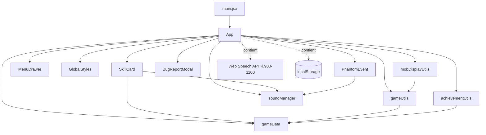

# DEBT.md — Registre de dette technique (CodeWashGame)

> Document vivant. Chaque PR de refactor référence un item `D-xx`. Les statuts sont mis à jour à chaque merge.
> Toute nouvelle dette découverte (ou introduite) est ajoutée ici.

- **Version du document :** v0.1 (mid-term)
- **Commit de référence (état reçu) :** `<tag P0-1, ex. v0.0-as-received>`
- **Dernière mise à jour :** `<date>`

> ⚠️ Les valeurs entre `<...>` sont à compléter après mesure. Les éléments marqués **(à vérifier)** viennent de l'analyse initiale et doivent être confirmés dans le code avant la défense.

---

## Sommaire

1. [Carte du codebase](#1-carte-du-codebase)
2. [Cartographie des I/O](#2-cartographie-des-io)
3. [Registre des dettes](#3-registre-des-dettes)
4. [Métriques de base](#4-métriques-de-base-avant-refactor)
5. [Matrice de risque et plan d'attaque](#5-matrice-de-risque-et-plan-dattaque)
6. [Lien avec GitHub](#6-lien-avec-github)
7. [Historique des mesures (avant / après)](#7-historique-des-mesures-avant--après)

---

## 1. Carte du codebase

### 1.1 Stack

| Élément | Valeur |
|---|---|
| UI | React (JSX) |
| Bundler | Vite, **forcé** vers `npm:rolldown-vite@7.2.5` via `overrides` dans `package.json` (non documenté → D-17) |
| Desktop | Electron + electron-builder (`.exe` portable Windows) |
| Tests | Aucun |
| Lint | ESLint (`eslint.config.js`), pas de formateur |
| CI | `build-exe.yml` : uniquement sur push `main`, uniquement build de l'exe |

### 1.2 Modules principaux

| Module | Taille | Rôle | Problème principal |
|---|---|---|---|
| `App.jsx` | 1492 l. | Composant racine : état global, boucle de combat, XP/niveaux, reconnaissance vocale, layout | God component |
| `GlobalStyles.jsx` | 1302 l. | Styles globaux injectés en JS | Styles mélangés au code |
| `SkillCard.jsx` | 778 l. | Rendu des compétences + règles de jeu | Domaine mélangé au rendu, JSX sur une ligne (l. 581–582) |
| `gameUtils.js` | `<à mesurer>` | Sélection de mobs, utilitaires de jeu | `Math.random()`, fonctions `getRandom*` dupliquées |
| `mobDisplayUtils.js` | `<à mesurer>` | Affichage des mobs | `Math.random()` |
| `soundManager.js` | `<à mesurer>` | Audio, singleton `getBGMManager()` | État global mutable, `new Audio`, `Math.random()` |
| `achievementUtils.js` | `<à mesurer>` | Succès | `Date.now()` / `new Date()` (l. 190) |
| `PhantomEvent.jsx` | `<à mesurer>` | Événement aléatoire | `Date.now()` |
| `BugReportModal.jsx` | 19 l. | Bouton de rapport de bug | Stub non fonctionnel |
| `MenuDrawer.jsx` / `MenuDrawer_old.jsx` | `<à mesurer>` / 231 l. | Menu latéral | `_old` est du code mort |
| `gameData.jsx`, `PixelHeart.jsx` | `<à mesurer>` | Données de jeu, icônes | Branding Minecraft en dur |

### 1.3 Graphe de dépendances (provisoire)

> À régénérer avec `madge` (voir §4) et à corriger si le réel diffère.



### 1.4 Où vit l'état

| État | Emplacement | Persistance |
|---|---|---|
| État du jeu (héros, combat, XP, niveau, succès) | `useState` dans `App.jsx` | `localStorage` |
| Compétences | `App.jsx` | `localStorage` clés `heroSkills_v23`, `_v1` + fallback legacy (D-11) |
| Musique de fond | Singleton `getBGMManager()` | Mémoire (global mutable) (D-08) |
| Reconnaissance vocale | Instance et timers dans `App.jsx` | Aucune |
| Thème | `<à vérifier>` | `<à vérifier>` |

---

## 2. Cartographie des I/O

| Type d'I/O | Où | Remarque | Item |
|---|---|---|---|
| `localStorage` | `App.jsx` (loaders/savers dispersés) | Clés versionnées, fallback inline | D-06, D-11 |
| Horloge `Date.now()` / `new Date()` | `App.jsx`, `achievementUtils.js:190`, `PhantomEvent.jsx` | Non injectable | D-04 |
| Aléatoire `Math.random()` | `gameUtils.js`, `mobDisplayUtils.js`, `SkillCard.jsx`, `soundManager.js` | Tests non déterministes | D-05 |
| Audio `new Audio(...)` | `SkillCard.jsx`, `soundManager.js` | Contourne le manager | D-07 |
| Web Speech API | `App.jsx` ~l. 900–1100 | Micro, auto-restart sur `onend` ~l. 1030 | D-09, D-13 |
| Plein écran (Fullscreen API) | `<à localiser>` | Appel direct au navigateur, non isolé (à confirmer par le `grep`) | D-26 |
| Réseau | `<à vérifier>` (aucun appel identifié pour l'instant) | À confirmer par `grep fetch|XMLHttpRequest|axios` | — |
| Electron (IPC / main process) | `<à vérifier>` | Comportement du micro différent navigateur vs `.exe` | D-17 |

**Commande de reproduction :**

```bash
grep -rnE "localStorage|Date\.now|new Date|Math\.random|new Audio|SpeechRecognition|webkitSpeechRecognition|requestFullscreen|fetch\(" src/ \
  | grep -v "^Binary" > docs/metrics/io-grep.txt
```

---

## 3. Registre des dettes

**Légende** — Impact / Risque : 🟢 faible, 🟠 moyen, 🔴 élevé. Effort : S (< 2 h), M (< 1 j), L (> 1 j). Statut : `todo` · `wip` · `done` · `wontfix`.

> **À faire :** la colonne *Localisation* doit citer le **fichier ET la fonction/composant** concerné (ex. `App.jsx › startRecognition`). Les numéros de ligne sont issus de l'analyse initiale : les confirmer dans le code.

### 3.1 Hygiène du dépôt et lancement

| ID | Localisation | Smell / problème | Impact | Risque | Effort | Priorité | Statut | Issue |
|---|---|---|---|---|---|---|---|---|
| D-01 | racine du dépôt | Aucun `.gitignore` ; `node_modules`, `dist/`, `release/` suivis par Git | 🔴 | 🟠 | S | P0 | todo | P1-3 |
| D-02 | tout l'arbre | 374 fichiers AppleDouble `._*` commités : arbre illisible, diffs bruités | 🟠 | 🟢 | S | P0 | todo | P1-4 |
| D-03 | racine | Pas de README ; lancement hors Windows non documenté et probablement cassé | 🔴 | 🟠 | M | P0 | todo | P1-1, P1-2, P1-7 |

### 3.2 Testabilité (I/O non isolées)

| ID | Localisation | Smell / problème | Impact | Risque | Effort | Priorité | Statut | Issue |
|---|---|---|---|---|---|---|---|---|
| D-04 | `App.jsx`, `achievementUtils.js:190`, `PhantomEvent.jsx` | `Date.now()` / `new Date()` en dur | 🔴 | 🟠 | M | P1 | todo | P4-4 |
| D-05 | `gameUtils.js`, `mobDisplayUtils.js`, `SkillCard.jsx`, `soundManager.js` | `Math.random()` en dur, tests non déterministes | 🔴 | 🟠 | M | P1 | todo | P4-5 |
| D-06 | `App.jsx` | `localStorage` appelé directement, partout | 🔴 | 🟠 | M | P1 | todo | P4-6 |
| D-07 | `SkillCard.jsx`, `soundManager.js` | `new Audio(...)` contourne `soundManager` | 🟠 | 🟢 | S | P2 | todo | P4-7 |
| D-08 | `soundManager.js` (`getBGMManager()`) | Singleton global mutable | 🟠 | 🟠 | M | P2 | todo | P4-8 |
| D-09 | `App.jsx` ~l. 900–1100 | Web Speech API utilisée directement, impossible à simuler | 🔴 | 🟠 | M | P1 | todo | P4-9 |
| D-26 | `<fichier / fonction à localiser>` | Fullscreen API appelée directement, non isolée derrière une interface (à confirmer par `grep`, supprimer l'entrée si absent) | 🟠 | 🟢 | S | P2 | todo | à créer (P2-6) |

### 3.3 Structure et couplage

| ID | Localisation | Smell / problème | Impact | Risque | Effort | Priorité | Statut | Issue |
|---|---|---|---|---|---|---|---|---|
| D-10 | `App.jsx` (1492 l.) | God component : état, combat, voix, layout | 🔴 | 🔴 | L | P1 | todo | P4-1 |
| D-11 | `App.jsx` (loaders) | Clés `heroSkills_v23`, `_v1` et fallback legacy dupliqués dans plusieurs loaders, pas de migrations | 🟠 | 🔴 | M | P2 | todo | P4-15 |
| D-12 | `SkillCard.jsx` (778 l.) | Règles de jeu dans le rendu ; JSX sur une ligne l. 581–582 | 🟠 | 🟠 | M | P2 | todo | P4-3 |
| D-13 | `App.jsx` ~l. 1030 | `onend` relance `setTimeout` sans backoff ni annulation : boucle potentielle | 🔴 | 🟠 | S | P1 | todo | P4-13 |
| D-14 | `GlobalStyles.jsx` (1302 l.) | Styles en JS monolithique, fuite dans le code | 🟠 | 🟢 | L | P3 | todo | P4-2 |
| D-15 | `gameUtils.js` | `getRandom*` quasi identiques (duplication) | 🟠 | 🟢 | S | P2 | todo | P4-16 |
| D-16 | `gameData.jsx`, `App.jsx`, `PixelHeart.jsx` | Branding Minecraft en dur ; bloque Thèmes et Traduction | 🟠 | 🟢 | M | P2 | todo | P4-17 |

### 3.4 Fiabilité et propreté

| ID | Localisation | Smell / problème | Impact | Risque | Effort | Priorité | Statut | Issue |
|---|---|---|---|---|---|---|---|---|
| D-17 | `package.json` ; builds navigateur vs Electron | Override `vite → rolldown-vite@7.2.5` non documenté ; deux cibles au comportement différent (micro) | 🟠 | 🟠 | S | P1 | todo | P1-5, P1-6 |
| D-18 | `App.jsx` (chemins de chargement) | `catch { console.warn(...) }` : erreurs silencieuses, aucun retour utilisateur | 🔴 | 🟠 | S | P1 | todo | P4-11 |
| D-19 | `App.jsx` (voix/micro) | `console.log` à chaque événement, pas de logger à niveaux | 🟢 | 🟢 | S | P3 | todo | P4-12 |
| D-20 | `App.jsx:50` | `parseInt` sans radix | 🟢 | 🟢 | S | P3 | todo | P4-14 |
| D-21 | `MenuDrawer_old.jsx` (231 l.) | Code mort | 🟢 | 🟢 | S | P3 | todo | P4-10 |
| D-22 | `BugReportModal.jsx` (19 l.) | Stub non fonctionnel | 🟠 | 🟢 | M | P4 | todo | P5-2 |

### 3.5 Dette process

| ID | Localisation | Problème | Impact | Risque | Effort | Priorité | Statut | Issue |
|---|---|---|---|---|---|---|---|---|
| D-23 | tout le dépôt | 0 test, aucune couverture | 🔴 | 🔴 | L | P0 | todo | P3-1, P3-2 |
| D-24 | `.github/workflows/build-exe.yml` | CI uniquement sur push `main`, ne fait que builder l'exe ; pas de lint, test, couverture, gates, analyse statique | 🔴 | 🟠 | M | P0 | todo | P3-3, P3-4, P3-5 |
| D-25 | racine | Pas de formateur (Prettier) | 🟢 | 🟢 | S | P2 | todo | P0-4 |

### 3.6 Dette introduite volontairement (à remplir)

> Tout seuil abaissé ou gate contourné doit être listé ici avec la raison.

| ID | Quoi | Pourquoi | Date | Plan de remboursement |
|---|---|---|---|---|
| — | — | — | — | — |

---

## 4. Métriques de base (avant refactor)

À capturer **sur le commit tagué P0-1**, avant toute modification de code. Les sorties brutes vont dans `docs/metrics/`.

| Métrique | Outil | Commande | Valeur avant |
|---|---|---|---|
| Couverture de tests | Vitest + `@vitest/coverage-v8` | `npx vitest run --coverage` | **0 %** (aucun test) |
| Taille des fichiers | `wc -l` / `cloc` | `cloc src/ --by-file` | App.jsx 1492 · GlobalStyles.jsx 1302 · SkillCard.jsx 778 · autres `<à mesurer>` |
| Complexité cyclomatique | ESLint règle `complexity` (seuil 10) ou `eslint-plugin-sonarjs` | `npx eslint src/ -f json -o docs/metrics/complexity.json` | `<à mesurer>` |
| Duplication | `jscpd` | `npx jscpd src/ --min-lines 5 --reporters console,json --output docs/metrics` | `<à mesurer>` |
| Graphe de dépendances | `madge` | `npx madge --image docs/metrics/deps.svg src/` | `<à générer>` |
| Cycles d'import | `madge` | `npx madge --circular src/` | `<à mesurer>` |
| Erreurs/avertissements lint | ESLint | `npx eslint src/` | `<à mesurer>` |
| Vulnérabilités | `npm audit` | `npm audit --json` | `<à mesurer>` |
| Poids du bundle | Vite build | `npm run build` | `<à mesurer>` |
| Temps de démarrage (pour la mission Performance) | Lighthouse / DevTools Performance | — | `<à mesurer>` |

Environnement de mesure : Node `<version>`, OS `<...>`, date `<...>`.

---

## 5. Matrice de risque et plan d'attaque

### 5.1 Matrice impact × vraisemblance

| Impact ↓ / Vraisemblance → | Faible | Moyenne | Élevée |
|---|---|---|---|
| **Élevé** | — | D-01, D-03, D-04, D-05, D-06, D-09, D-13, D-18, D-24 | D-10, D-23 |
| **Moyen** | D-02, D-07, D-14, D-15, D-16, D-22, D-26 | D-08, D-12, D-17 | D-11 |
| **Faible** | D-19, D-20, D-21, D-25 | — | — |

> Chaque dette est placée selon ses colonnes Impact (ligne) et Risque (colonne) du §3 : si tu modifies l'une, modifie l'autre. Première estimation à discuter en équipe et à ajuster après les premiers tests de caractérisation. La case « Élevé × Moyenne » est très chargée : affiner les niveaux de risque après lecture détaillée du code.

### 5.2 Plan d'attaque par phases

| Phase | Items | Pourquoi dans cet ordre |
|---|---|---|
| **0. Hygiène** | D-01, D-02, D-03, D-17 | Sans dépôt propre ni lancement documenté, rien d'autre n'est lisible ni reproductible. |
| **1. Filet de sécurité** | D-23, D-24, D-25 | Règle du sujet : aucun refactor mergé sans tests ni CI. |
| **2. Rendre testable** | D-04, D-05, D-06, D-09, D-07, D-08, D-26 | Horloge, RNG, stockage et voix injectables = prérequis de tests fiables. |
| **3. Découper** | D-10, D-12, D-14, D-11, D-15 | Une fois testé et injecté, le découpage devient sûr. |
| **4. Points chauds** | D-13, D-18, D-16 | Bugs de fiabilité ; D-16 débloque Thèmes et Traduction. |
| **5. Nettoyage** | D-19, D-20, D-21 | Faible risque, à faire au fil des PR (règle du scout). |
| **6. Missions** | D-22 + features | Après stabilisation du socle. |

---

## 6. Lien avec GitHub

- Chaque ligne du registre devient une issue avec les labels `debt`, `type:<refactor|bug|docs|chore|test|ci>`, `prio:P0..P4`, `effort:S|M|L`.
- Chaque PR contient `Refs D-xx` / `Closes #n` et met à jour le statut ici.
- Table de correspondance : voir la colonne **Issue** du §3 (identifiants du backlog P*-*), à remplacer par les numéros GitHub `#n` après création.

---

## 7. Historique des mesures (avant / après)

| Métrique | Avant (reçu) | Après M3 | Après M4 | Final |
|---|---|---|---|---|
| Couverture | 0 % | | | |
| App.jsx (lignes) | 1492 | | | |
| GlobalStyles.jsx (lignes) | 1302 | | | |
| SkillCard.jsx (lignes) | 778 | | | |
| Duplication (%) | `<à mesurer>` | | | |
| Complexité max | `<à mesurer>` | | | |
| Erreurs lint | `<à mesurer>` | | | |
