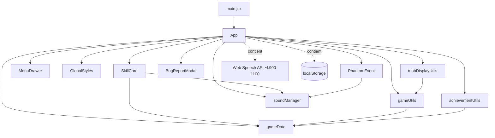

# DEBT.md — Registre de dette technique (CodeWashGame)

> Document vivant. Chaque PR de refactor référence un item `D-xx`. Les statuts sont mis à jour à chaque merge.
> Toute nouvelle dette découverte (ou introduite) est ajoutée ici.

- **Version du document :** v1.0 (mid-term)
- **Commit de référence (état reçu) :** `25b3629` — tag `v0.0-as-received`
- **Dernière mise à jour :** 2026-11-19
- **Mesures :** fichiers bruts dans `docs/metrics/`, synthèse au §4.

Légende des statuts : `todo` · `wip` · `done` · `wontfix`.
Une entrée `wip` dont le correctif vit sur une autre branche indique la branche et le commit.

---

## Sommaire

1. [Carte du codebase](#1-carte-du-codebase)
2. [Cartographie des I/O](#2-cartographie-des-io)
3. [Registre des dettes](#3-registre-des-dettes)
4. [Métriques de base](#4-métriques-de-base-avant-refactor)
5. [Matrice de risque et plan d'attaque](#5-matrice-de-risque-et-plan-dattaque)
6. [Lien avec GitHub](#6-lien-avec-github)
7. [Historique des mesures (avant / après)](#7-historique-des-mesures-avant--après)

---

## 1. Carte du codebase

### 1.1 Stack

| Élément | Valeur |
|---|---|
| UI | React 19 (JSX) |
| Bundler | Vite, **forcé** vers `npm:rolldown-vite@7.2.5` via `overrides` dans `package.json` (documenté dans le README → D-17) |
| Desktop | Electron 39 + electron-builder (`.exe` portable Windows) |
| Tests | Aucun |
| Lint | ESLint 9 (flat config), pas de formateur |
| CI | `build-exe.yml` : uniquement sur push `main`, uniquement build de l'exe |

### 1.2 Modules principaux (mesurés avec `wc -l`)

| Module | Taille | Rôle | Problème principal |
|---|---|---|---|
| `src/App.jsx` | 1492 l. | Composant racine : état global, boucle de combat, XP/niveaux, reconnaissance vocale, layout | God component (D-10) |
| `src/components/ui/GlobalStyles.jsx` | 1302 l. | Styles globaux injectés en JS | Styles mélangés au code (D-14) |
| `src/components/skills/SkillCard.jsx` | 778 l. | Rendu des compétences + règles de jeu | Domaine mélangé au rendu ; JSX sur une ligne l. 581–582 (D-12) |
| `src/constants/gameData.jsx` | 416 l. | Données de jeu, `THEME_CONFIG`, `SKILL_DATA` | Branding Minecraft en dur (D-16) |
| `src/utils/gameUtils.js` | 363 l. | Sélection de mobs, calculs de combat/XP, génération de problèmes | `Math.random()`, fonctions `getRandom*` dupliquées (D-05, D-15) |
| `src/components/drawers/CosmeticsDrawer.jsx` | 322 l. | Cosmétiques | Complexité 21 et 15 |
| `src/constants/achievements.js` | 318 l. | Définition des succès | Données monolithiques |
| `src/utils/soundManager.js` | 287 l. | Audio, singleton `getBGMManager()` | État global mutable, `new Audio`, `Math.random()` (D-07, D-08) |
| `src/components/drawers/MenuDrawer.jsx` | 262 l. | Menu latéral | Complexité 27 ; dupliqué avec `_old` (D-15) |
| `src/components/drawers/MenuDrawer_old.jsx` | 231 l. | Ancien menu | Code mort (D-21) |
| `src/utils/achievementUtils.js` | 217 l. | Succès | `Date.now()` / `new Date()` (D-04) |
| `src/components/PhantomEvent.jsx` | 150 l. | Événement aléatoire | `Date.now()`, clé `localStorage` propre (D-04, D-31) |
| `src/components/profile/ProfileCard.jsx` | 142 l. | Carte de profil | Complexité 11 |
| `src/components/ui/ParentalVerificationModal.jsx` | 125 l. | Contrôle parental | — |
| `src/components/modals/ResetModal.jsx` | 107 l. | Réinitialisation | — |
| `src/components/ui/PixelHeart.jsx` | 93 l. | Icônes | Branding Minecraft (D-16) |
| `src/components/ui/AchievementToast.jsx` | 82 l. | Toast de succès | — |
| `src/components/drawers/SettingsDrawer.jsx` | 67 l. | Réglages | — |
| `src/components/ui/MobWithAura.jsx` | 57 l. | Affichage mob | Complexité 11 |
| `src/index.css` | 53 l. | Styles d'entrée | — |
| `src/utils/mobDisplayUtils.js` | 44 l. | Aura des mobs | `Math.random()` (D-05) |
| `src/constants/assets.js` | 36 l. | Chemins d'assets | — |
| `src/components/ui/SafeImage.jsx` | 19 l. | Image avec fallback | Erreurs silencieuses (D-32) |
| `src/components/modals/BugReportModal.jsx` | 19 l. | Rapport de bug | Stub non fonctionnel (D-22) |
| `src/main.jsx` | 9 l. | Point d'entrée React | — |

### 1.3 Graphe de dépendances

Généré avec `madge` — 49 fichiers traités, **aucun cycle d'import**.

- Image : `docs/metrics/deps.svg`
- Données : `docs/metrics/madge-deps.json`
- Cycles : `docs/metrics/madge-circular.txt`



### 1.4 Où vit l'état

| État | Emplacement | Persistance |
|---|---|---|
| État du jeu (héros, combat, XP, niveau, succès) | `useState` dans `App.jsx` | `localStorage` |
| Compétences | `App.jsx` (`loadSkills`, l. 56) | `localStorage` clés `heroSkills_v23`, `_v1` + fallback legacy (D-11) |
| Thème | `App.jsx` (`loadTheme`, l. 172) + `THEME_CONFIG` | `localStorage` (dans l'objet `skills`) (D-28) |
| Musique de fond | Singleton `getBGMManager()` (`soundManager.js`) | Mémoire (global mutable) (D-08) |
| Reconnaissance vocale | `recognitionRef` et timers dans `App.jsx` | Aucune |
| Cooldown PhantomEvent | `PhantomEvent.jsx` (clé `phantomEvent_lastSpawn_v1`) | `localStorage` (D-31) |

---

## 2. Cartographie des I/O

| Type d'I/O | Où | Remarque | Item |
|---|---|---|---|
| `localStorage` | `App.jsx` : `loadSkills` (56), `loadTheme` (172), `loadStats` (185), `getProfileStats` (202), sauvegarde (284), `handleReset` (964) | Clés versionnées, fallback inline | D-06, D-11 |
| `localStorage` | `PhantomEvent.jsx` : clé `phantomEvent_lastSpawn_v1` (5, 21, 55) | Clé propre hors du schéma central | D-31 |
| Horloge `Date.now()` / `new Date()` | `App.jsx` `useEffect` login (1117), `achievementUtils.js:190`, `PhantomEvent.jsx:22,55` | Non injectable | D-04 |
| Aléatoire `Math.random()` | `gameUtils.js`, `mobDisplayUtils.js`, `SkillCard.jsx` (102/228/245/248/320/357/361), `soundManager.js:111` | Tests non déterministes | D-05 |
| Audio `new Audio(...)` | `SkillCard.jsx` (102, 228, 338, 374, 409), `soundManager.js` (183, 253, 267, 281) | Contourne le manager | D-07 |
| Web Speech API | `App.jsx` : `startVoiceListener` (999), `stopVoiceRecognition` (985), `toggleMicListener` (1083) | Auto-restart sur `onend` (~1030) | D-09, D-13 |
| Fullscreen API | `App.jsx` : `handleFullscreenChange` (351), `toggleFullscreen` (370–380) | Appel direct au navigateur, non isolé | D-26 |
| Réseau | Aucun appel `fetch`/`XMLHttpRequest`/`axios` identifié dans `src/` | Aucune I/O réseau aujourd'hui | — |
| Electron (IPC / main process) | `electron/main.cjs` | Pas d'IPC ; `nodeIntegration: false`, `contextIsolation: true`. Différence micro navigateur vs `.exe` | D-17 |

**Commandes de reproduction :**

```bash
grep -rnE "localStorage|Date\.now|new Date|Math\.random|new Audio|SpeechRecognition|webkitSpeechRecognition|requestFullscreen|fetch\(" src/ \
  | grep -vE '(^|/)\._' > docs/metrics/io-grep.txt

npx eslint . --ignore-pattern '**/._*' -f json -o docs/metrics/eslint-clean.json
npx eslint src/ --rule '{"complexity":["error",10]}' -f json -o docs/metrics/complexity.json
npx jscpd src/ --min-lines 5 --min-tokens 50 --ignore '**/._*' --reporters console,json --output docs/metrics
npx madge --circular --extensions js,jsx src/
npx madge --image docs/metrics/deps.svg --extensions js,jsx src/
npm audit --json > docs/metrics/npm-audit.json
npm run build
```

> Les commandes `eslint`/`jscpd`/`madge` s'exécutent depuis `CodeWashGame/` ; adapter les chemins `../docs/metrics/` en conséquence.

---

## 3. Registre des dettes

**Légende** — Impact / Risque : 🟢 faible, 🟠 moyen, 🔴 élevé. Effort : S (< 2 h), M (< 1 j), L (> 1 j). Statut : `todo` · `wip` · `done` · `wontfix`.

### 3.1 Hygiène du dépôt et lancement

| ID | Localisation | Smell / problème | Impact | Risque | Effort | Priorité | Statut | Issue |
|---|---|---|---|---|---|---|---|---|
| D-01 | racine du dépôt — `.gitignore` | Aucun `.gitignore` utile ; `node_modules/`, `dist/`, `release/` non ignorés | 🔴 | 🟠 | S | P0 | done — merge `4caa03e` | P1-3 |
| D-02 | tout l'arbre | 374 fichiers AppleDouble `._*` commités : arbre illisible, diffs bruités, 28 faux erreurs de lint | 🟠 | 🟢 | S | P0 | done — merge `4caa03e` | P1-4 |
| D-03 | racine — `README.md` | Pas de README ; lancement hors Windows non documenté | 🔴 | 🟠 | M | P0 | done — merge `d0ce4c1` | P1-1, P1-2, P1-7 |

### 3.2 Testabilité (I/O non isolées)

| ID | Localisation | Smell / problème | Impact | Risque | Effort | Priorité | Statut | Issue |
|---|---|---|---|---|---|---|---|---|
| D-04 | `App.jsx › useEffect` login (1117), `achievementUtils.js:190`, `PhantomEvent.jsx:22,55` | `Date.now()` / `new Date()` en dur | 🔴 | 🟠 | M | P1 | todo | P4-4 |
| D-05 | `gameUtils.js`, `mobDisplayUtils.js`, `SkillCard.jsx`, `soundManager.js:111` | `Math.random()` en dur, tests non déterministes | 🔴 | 🟠 | M | P1 | todo | P4-5 |
| D-06 | `App.jsx` : `loadSkills`, `loadTheme`, `loadStats`, `getProfileStats`, sauvegarde (284), `handleReset` | `localStorage` appelé directement, partout | 🔴 | 🟠 | M | P1 | todo | P4-6 |
| D-07 | `SkillCard.jsx` (102, 228, 338, 374, 409), `soundManager.js` (183, 253, 267, 281) | `new Audio(...)` contourne `soundManager` | 🟠 | 🟢 | S | P2 | todo | P4-7 |
| D-08 | `soundManager.js › getBGMManager()` (157, 166) | Singleton global mutable (`bgmManagerInstance`, `sfxVolume`) | 🟠 | 🟠 | M | P2 | todo | P4-8 |
| D-09 | `App.jsx › startVoiceListener` (999), `stopVoiceRecognition` (985), `toggleMicListener` (1083) | Web Speech API utilisée directement, impossible à simuler | 🔴 | 🟠 | M | P1 | todo | P4-9 |
| D-26 | `App.jsx › toggleFullscreen` (370–380), `handleFullscreenChange` (351) | Fullscreen API appelée directement, non isolée derrière une interface | 🟠 | 🟢 | S | P2 | todo | à créer |

### 3.3 Structure et couplage

| ID | Localisation | Smell / problème | Impact | Risque | Effort | Priorité | Statut | Issue |
|---|---|---|---|---|---|---|---|---|
| D-10 | `App.jsx` (1492 l., `const App`) | God component : état, combat, voix, layout ; complexité max 31 | 🔴 | 🔴 | L | P1 | todo | P4-1 |
| D-11 | `App.jsx` : `getStorageKey` (55), `loadSkills` (56), `loadTheme` (172), `loadStats` (185), `getProfileStats` (202) | Clés `heroSkills_v23`, `_v1` et fallback legacy dupliqués, pas de migrations | 🟠 | 🔴 | M | P2 | todo | P4-15 |
| D-12 | `SkillCard.jsx` (778 l.) | Règles de jeu dans le rendu ; JSX sur une ligne l. 581–582 ; complexité 107 | 🟠 | 🟠 | M | P2 | todo | P4-3 |
| D-13 | `App.jsx › startVoiceListener`, handler `onend` (~1030) | `onend` relance `setTimeout` sans backoff ni annulation : boucle potentielle | 🔴 | 🟠 | S | P1 | todo | P4-13 |
| D-14 | `GlobalStyles.jsx` (1302 l.) | Styles en JS monolithique, fuite dans le code | 🟠 | 🟢 | L | P3 | todo | P4-2 |
| D-15 | `gameUtils.js` (`getRandomMob`, `getRandomFriendlyMob`, `getRandomMiniboss`, `getRandomBoss`, `getMobForSkill`) ; `MenuDrawer.jsx` ↔ `MenuDrawer_old.jsx` | Duplication : 2,53 % de lignes, 6 clones, 144 lignes dupliquées | 🟠 | 🟢 | S | P2 | todo | P4-16 |
| D-16 | `gameData.jsx` (`THEME_CONFIG`, `SKILL_DATA`), `App.jsx` (`THEME_CONFIG.minecraft`, 1140), `PixelHeart.jsx` | Branding Minecraft en dur ; bloque Thèmes et Traduction | 🟠 | 🟢 | M | P2 | todo | P4-17 |

### 3.4 Fiabilité et propreté

| ID | Localisation | Smell / problème | Impact | Risque | Effort | Priorité | Statut | Issue |
|---|---|---|---|---|---|---|---|---|
| D-17 | `package.json` (`overrides.vite`) ; builds navigateur vs Electron | Override `vite → rolldown-vite@7.2.5` non documenté ; deux cibles au comportement différent (micro) | 🟠 | 🟠 | S | P1 | done — README (`12cea5f`) | P1-5, P1-6 |
| D-18 | `App.jsx` : `loadSkills` (92–170), `loadTheme` (178), `loadStats` (191), `getProfileStats` (224) | `catch { console.warn(...) }` : erreurs silencieuses, aucun retour utilisateur | 🔴 | 🟠 | S | P1 | todo | P4-11 |
| D-19 | `App.jsx` : `startVoiceListener`, `stopVoiceRecognition`, `toggleMicListener`, `endBattle` | `console.log` à chaque événement, pas de logger à niveaux | 🟢 | 🟢 | S | P3 | todo | P4-12 |
| D-20 | `App.jsx:50` | `parseInt` sans radix | 🟢 | 🟢 | S | P3 | todo | P4-14 |
| D-21 | `MenuDrawer_old.jsx` (231 l.) | Code mort | 🟢 | 🟢 | S | P3 | todo | P4-10 |
| D-22 | `BugReportModal.jsx` (19 l.) | Stub non fonctionnel | 🟠 | 🟢 | M | P4 | todo | P5-2 |
| D-27 | `src/**` (ex. `App.jsx`, `MenuDrawer.jsx`, `ResetModal.jsx`, `BugReportModal.jsx`) | Chaînes d'interface codées en dur en anglais ; aucune couche i18n ; bloque la mission Traduction | 🟠 | 🟠 | M | P4 | todo | P5-3 |
| D-28 | `gameData.jsx` (`THEME_CONFIG`), `App.jsx › loadTheme`/`handleThemeChange` (172, 824), assets par thème | Système de thèmes incomplet : toutes les images ne changent pas, tailles incohérentes, jeux et audio non thémés, pas de barre de défilement | 🟠 | 🟠 | L | P4 | todo | P5-4 |
| D-29 | `App.jsx` rendu initial ; `dist/assets` | Démarrage/menu lents ; aucun découpage de code ; `dist` = 244 Mo dont 4 WAV de 34–48 Mo ; aucune mesure de démarrage | 🔴 | 🟠 | L | P4 | todo | P5-1 |
| D-30 | `App.jsx` : `handleSuccessHit`, `checkAchievements`, effets de toasts/level-up | Nombreux `setTimeout` non nettoyés au démontage (mises à jour d'état après unmount) | 🟠 | 🟠 | M | P2 | todo | à créer |
| D-31 | `PhantomEvent.jsx:5,21,55` | Clé `localStorage` propre (`phantomEvent_lastSpawn_v1`) hors schéma central | 🟢 | 🟢 | S | P2 | todo | P4-6 |
| D-32 | `SafeImage.jsx:6–17` | Erreur de chargement d'image avalée silencieusement (fallback sans log) | 🟢 | 🟢 | S | P3 | todo | P4-11 |

### 3.5 Dette process

| ID | Localisation | Problème | Impact | Risque | Effort | Priorité | Statut | Issue |
|---|---|---|---|---|---|---|---|---|
| D-23 | tout le dépôt | 0 test, aucune couverture | 🔴 | 🔴 | L | P0 | todo | P3-1, P3-2 |
| D-24 | `.github/workflows/build-exe.yml` | CI uniquement sur push `main`, ne fait que builder l'exe ; pas de lint, test, couverture, gates, analyse statique | 🔴 | 🟠 | M | P0 | todo | P3-3, P3-4, P3-5 |
| D-25 | racine | Pas de formateur (Prettier) | 🟢 | 🟢 | S | P2 | todo | P0-4 |
| D-33 | PR #3, PR #4 ; absence de gate PR | Des PR « vides » (fichiers de 0 octet) ont été mergées sans CI : le process n'a pas détecté l'absence de contenu | 🟠 | 🟠 | S | P0 | wip — gates à ajouter en M3 | P3-3, P3-4 |

### 3.6 Dette introduite volontairement (à remplir)

> Tout seuil abaissé ou gate contourné doit être listé ici avec la raison.

| ID | Quoi | Pourquoi | Date | Plan de remboursement |
|---|---|---|---|---|
| — | — | — | — | — |

---

## 4. Métriques de base (avant refactor)

Mesures prises sur l'état reçu (`25b3629` / tag `v0.0-as-received`), **avant tout refactor**, depuis `CodeWashGame/`. Sorties brutes : `docs/metrics/`.

**Environnement :** Node `v20.20.2`, npm `10.8.2`, Linux `6.6.87.2-microsoft-standard-WSL2`, le 2026-11-19.

| Métrique | Outil | Commande | Valeur avant |
|---|---|---|---|
| Couverture de tests | Vitest + `@vitest/coverage-v8` | `npx vitest run --coverage` | **0 %** (aucun test, runner absent) |
| Taille des fichiers | `wc -l` | `find src -type f \( -name '*.js' -o -name '*.jsx' -o -name '*.css' \) \| xargs wc -l` | 6 991 lignes au total ; `App.jsx` 1492, `GlobalStyles.jsx` 1302, `SkillCard.jsx` 778 (détail §1.2) |
| Complexité cyclomatique | ESLint règle `complexity` (seuil 10) | `npx eslint src/ --rule '{"complexity":["error",10]}'` | **14 fonctions > 10** ; max **107** (`SkillCard.jsx › composant principal`, l. 65) ; `App.jsx` 16/31/17/24/16 ; `MenuDrawer.jsx` 27 |
| Duplication | `jscpd` | `npx jscpd src/ --min-lines 5 --min-tokens 50` | **2,53 %** des lignes (144/5686), 992 tokens, **6 clones** ; plus gros clone 78 lignes (`MenuDrawer.jsx` ↔ `MenuDrawer_old.jsx`) |
| Graphe de dépendances | `madge` | `npx madge --image docs/metrics/deps.svg --extensions js,jsx src/` | 49 fichiers traités ; image `docs/metrics/deps.svg` |
| Cycles d'import | `madge` | `npx madge --circular --extensions js,jsx src/` | **0 cycle** |
| Erreurs/avertissements lint | ESLint 9 | `npx eslint .` | **28 erreurs** sur l'arbre brut, **toutes** des erreurs de parsing sur les fichiers `._*` ; **0 erreur / 0 warning** sur les 28 sources réelles (`docs/metrics/eslint-clean.json`) |
| Vulnérabilités | `npm audit` | `npm audit --json` | **31** : 1 critique, 20 élevées, 9 modérées, 1 faible (`docs/metrics/npm-audit.json`) |
| Poids du bundle | `vite build` (rolldown) | `npm run build` | JS **362,79 kB** (gzip 102,62) ; CSS **61,78 kB** (gzip 11,07) ; HTML 0,46 kB ; build en **4,67 s** |
| Poids total des assets | `du`, `find` | `du -sh dist` | **244 Mo**, dominés par les WAV BGM : `piano3.wav` 48 Mo, `calm1.wav` 45 Mo, `calm3.wav` 39 Mo, `calm2.wav` 34 Mo |
| Temps de démarrage | Lighthouse / DevTools Performance | — | **non mesuré** (nécessite un runtime graphique) — baseline à capturer au début de la mission Performance (D-29) |

---

## 5. Matrice de risque et plan d'attaque

### 5.1 Matrice impact × vraisemblance

| Impact ↓ / Vraisemblance → | Faible | Moyenne | Élevée |
|---|---|---|---|
| **Élevé** | — | D-01, D-03, D-04, D-05, D-06, D-09, D-13, D-18, D-24, D-29 | D-10, D-23 |
| **Moyen** | D-02, D-07, D-14, D-15, D-16, D-22, D-26 | D-08, D-12, D-17, D-27, D-28, D-30, D-33 | D-11 |
| **Faible** | D-19, D-20, D-21, D-25, D-31, D-32 | — | — |

> Chaque dette est placée selon ses colonnes Impact (ligne) et Risque (colonne) du §3 : si l'une change, l'autre doit changer.

### 5.2 Plan d'attaque par phases

| Phase | Items | Pourquoi dans cet ordre |
|---|---|---|
| **0. Hygiène** | D-01, D-02, D-03, D-17, D-33 | Sans dépôt propre, lancement documenté ni gate PR, rien d'autre n'est lisible ni reproductible. |
| **1. Filet de sécurité** | D-23, D-24, D-25 | Règle du sujet : aucun refactor mergé sans tests ni CI. |
| **2. Rendre testable** | D-04, D-05, D-06, D-09, D-07, D-08, D-26, D-30, D-31 | Horloge, RNG, stockage, voix et timers injectables = prérequis de tests fiables. |
| **3. Découper** | D-10, D-12, D-14, D-11, D-15, D-32 | Une fois testé et injecté, le découpage devient sûr. |
| **4. Points chauds** | D-13, D-18, D-16 | Bugs de fiabilité ; D-16 débloque Thèmes et Traduction. |
| **5. Nettoyage** | D-19, D-20, D-21 | Faible risque, à faire au fil des PR (règle du scout). |
| **6. Missions** | D-22, D-27, D-28, D-29 + features | Après stabilisation du socle. Capturer la baseline de démarrage (D-29) dès le début de la mission. |

---

## 6. Lien avec GitHub

- Chaque ligne du registre devient une issue avec les labels `debt`, `type:<refactor|bug|docs|chore|test|ci>`, `prio:P0..P4`, `effort:S|M|L`.
- Chaque PR contient `Refs D-xx` / `Closes #n` et met à jour le statut ici.
- La colonne **Issue** du §3 contient les identifiants du backlog interne (`P*-*`, plan de travail). Elle sera remplacée par les numéros GitHub `#n` à la création des issues.
- **État au 2026-11-19 :** la CLI `gh` n'est pas disponible dans l'environnement de travail courant ; création des issues à faire depuis un poste authentifié (voir le plan de travail). Les identifiants `P*-*` restent la référence tant que ce n'est pas fait.

---

## 7. Historique des mesures (avant / après)

| Métrique | Avant (reçu) | Après M3 | Après M4 | Final |
|---|---|---|---|---|
| Couverture | 0 % | | | |
| App.jsx (lignes) | 1492 | | | |
| GlobalStyles.jsx (lignes) | 1302 | | | |
| SkillCard.jsx (lignes) | 778 | | | |
| Duplication (%) | 2,53 % | | | |
| Complexité max | 107 | | | |
| Erreurs lint (sources réelles) | 0 | | | |
| Vulnérabilités npm | 31 | | | |
| Bundle JS (gzip) | 102,62 kB | | | |
| Taille `dist` | 244 Mo | | | |
